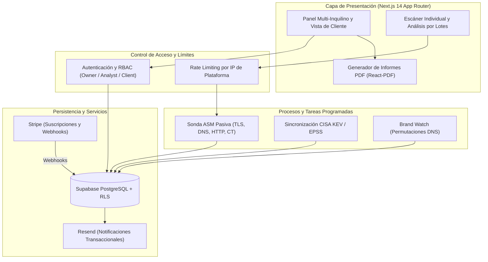

# Vigilhead

Quería crear una plataforma de gestión de superficie de ataque externa (EASM) que no se limitara a listar cabeceras HTTP faltantes, sino que ayudara a priorizar riesgos reales y a traducir los hallazgos técnicos a marcos de cumplimiento normativo. Empecé desarrollándolo como una herramienta para auditar dominios individuales y lo fui escalando hacia una arquitectura multi-inquilino pensada para gestionar múltiples clientes desde un mismo panel.

Actualmente lo tengo funcionando en entorno local (`localhost`) en fase de desarrollo y pruebas. El código fuente lo mantengo en un repositorio privado, así que en este repositorio documento la arquitectura, las decisiones técnicas que fui tomando y algunas capturas de la aplicación.

## Capturas del entorno local

| Panel de control y priorización | Matriz de cumplimiento e informe PDF |
| :--- | :--- |
|  |  |
| *Inventario de activos observados con puntuación de riesgo y estado de controles.* | *Generación dinámica de informes multipágina con personalización de marca.* |

## Arquitectura

Para que el sistema fuera estable y escalable, separé la capa de presentación, el control de cuotas y acceso, los procesos asíncronos de escaneo y la base de datos:

## Qué construí y cómo funciona

* **Reconocimiento pasivo y Priority Score:** Hice que el motor separara la higiene básica de configuración (escala A–F) del riesgo operativo real (escala 0–100). Implementé inspecciones no intrusivas mediante *sockets* TLS/SSL, consultas de registros DNS (`SPF`, `DMARC`, `CAA`, `MX`), análisis de cabeceras HTTP y búsqueda en registros públicos de *Certificate Transparency*. A partir de las tecnologías detectadas, crucé los activos con el catálogo CISA KEV y métricas EPSS, añadiendo un seguimiento histórico de episodios para penalizar las exposiciones que llevan semanas abiertas.

* **Mapeo de cumplimiento normativo:** Como los perfiles de dirección necesitan ver impacto de negocio y no solo detalles de configuración, construí un módulo que mapea los controles técnicos observados frente a requisitos específicos de NIS2, DORA, ISO/IEC 27001 y SOC 2. En toda la interfaz y en los informes dejé explícito qué fracción del marco puede sostener una sonda externa.

* **Vigilancia de marca (Brand Watch):** Para evitar que la búsqueda de dominios similares bloqueara las auditorías principales, lo monté como un proceso independiente. El algoritmo genera variantes sobre el dominio principal (omisión de caracteres, transposición, proximidad en teclado QWERTY, cambios de TLD y homoglifos) y ejecuta únicamente resoluciones DNS pasivas (`A`, `AAAA`, `MX`, `TXT`) para no realizar peticiones HTTP contra sitios potencialmente maliciosos.

* **Remediación adaptada al stack e informes PDF:** Añadí *fingerprinting* pasivo para entregar fragmentos de configuración listos para aplicar según la tecnología detectada (`Next.js`, `Express`, `Nginx`, `Apache`, `Cloudflare` y zonas `BIND`). También desarrollé un generador de informes PDF multipágina con `@react-pdf/renderer` que reúne la postura del activo, las instantáneas de cumplimiento, las alertas de marca y el anexo técnico, permitiendo personalizar logotipo y colores corporativos.

* **Seguridad de la plataforma y aislamiento de datos:** Diseñé el modelo multi-inquilino en Supabase aplicando políticas de *Row-Level Security* (RLS) en PostgreSQL según el rol de cada usuario (`owner`, `analyst`, `client`). Para evitar abusos en el escáner sin sesión, implementé un límite diario transaccional que descarta cabeceras falsificables (`X-Forwarded-For`) y toma únicamente la IP inyectada por la infraestructura de red (`x-vercel-forwarded-for`, `cf-connecting-ip`). Además, añadí una bitácora de auditoría que redacta automáticamente tokens o secretos y conecté la gestión de suscripciones con *webhooks* de Stripe y notificaciones vía Resend.

## Stack utilizado

* **Frontend y API:** Next.js 14 (App Router, Server Actions), React, TypeScript (modo estricto) y Tailwind CSS.
* **Base de datos y autenticación:** Supabase (PostgreSQL, Auth y Row-Level Security).
* **Red y documentos:** Node.js (`node:dns/promises`, `node:tls`) y `@react-pdf/renderer`.
* **Servicios externos:** Stripe y Resend.